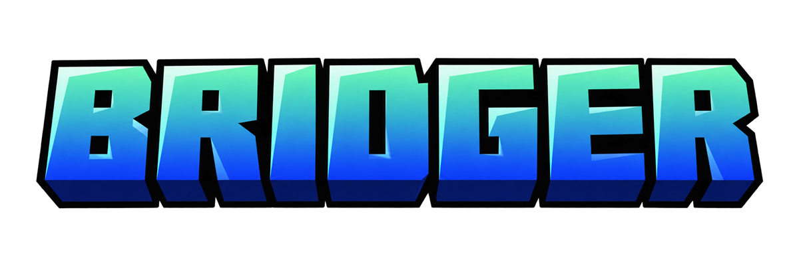
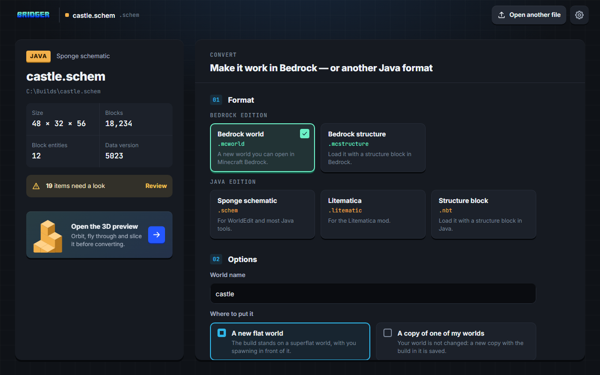
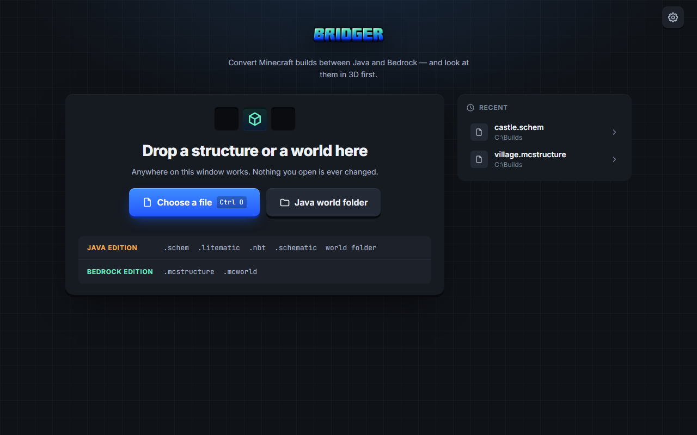
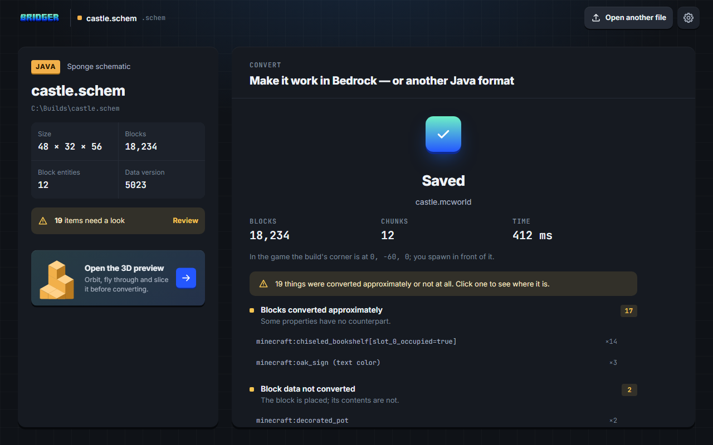

<p align="center">
  
</p>

<p align="center">
  <b>Convert Minecraft builds between Java and Bedrock — and look at them in 3D first.</b><br>
  Schematics, structures and whole worlds. Native, fast, and it never loses data silently.
</p>

<p align="center">
  <a href="https://github.com/MEMOxiiii/bridger/releases/latest"></a>
  <a href="https://github.com/MEMOxiiii/bridger/actions/workflows/ci.yml"></a>
  
  
  <a href="LICENSE"></a>
</p>

<p align="center">
  
</p>

## Why Bridger

Moving builds between Minecraft Java Edition and Bedrock Edition is painful. Existing tools are slow on large
inputs, lose data silently (block orientations, waterlogging, chest contents), and handle the most common request
badly: **taking a Java schematic and getting a working Bedrock world** (`.schem` → `.mcworld`).

- **Both directions.** Java schematics and worlds to Bedrock, and Bedrock structures and worlds back to Java.
- **Nothing lost silently.** Anything that cannot be converted exactly is counted in a report, and the desktop app
  shows you where it is in 3D.
- **Your files are safe.** Inputs are never modified; outputs are validated before they replace anything.
- **Fast, and measured.** Native C++20; every speed claim has a benchmark behind it
  ([docs/performance.md](docs/performance.md)).

## Download

Get `bridger-<version>-windows-x64.zip` from the [latest release](https://github.com/MEMOxiiii/bridger/releases/latest)
and unzip it anywhere. No installer; the Visual C++ runtime is included.

- **`bridger-gui.exe`** — the desktop app. Needs the Microsoft Edge WebView2 Runtime (part of Windows 11 and current
  Windows 10). The 3D preview needs a GPU with Vulkan 1.3; without one the app still opens and converts files.
- **`bridger.exe`** — the command line, for scripts and batch jobs.

## Desktop app

<p align="center">
  
  
</p>

1. **Open** — drop a file or world anywhere on the window, or choose one.
2. **Check** — the file page shows what is in it and anything that could not be read exactly.
3. **Preview (optional)** — open the 3D view: orbit, pan, zoom; **fly** like a player (double-click or F, then
   WASD, Space/Shift, Ctrl to sprint, Esc to stop); a top-down **map** (M); a **slice** to look inside. Worlds
   stream in around you. **Back to convert** returns to the same file.
4. **Convert** — pick the format, a name, where to put it (a new world, or a copy of one of your worlds at a
   position) and where to save. Progress can be cancelled; nothing is written then. The report links every
   approximation to its blocks in 3D.

The 3D preview uses the textures of your own Minecraft Java 26.3 installation
(`%APPDATA%/.minecraft/versions/26.3/26.3.jar`, or a client jar you choose in Settings) plus any resource packs you
add. Without Minecraft Java, the app offers to download that file (about 40 MB) from Mojang's official servers, only
when you ask, verified against Mojang's published hash. Converting works without any of it.

## Command line

```text
bridger formats                                   # formats and their support status
bridger info <file or world folder>               # describe any supported structure file or world
bridger convert <input> <output> [options]        # any supported pair
    --report report.json   --fallback air|marker   --format <name>   --threads N   --overwrite
    --into-world <existing.mcworld>   --place-at x,y,z   --air keep|replace   --clear-entities
    --clip | --shift-to-fit
bridger render <file or world> out.png [--size WxH --map --slice Y --pack p.zip]   # 3D screenshot
```

```text
bridger convert castle.schem castle.mcworld --report castle-report.json
bridger convert castle.litematic castle.mcstructure
bridger convert "C:\saves\My Java World" my-world.mcworld
bridger convert tower.nbt out.mcworld --into-world survival.mcworld --place-at 120,64,-40
bridger convert house.mcstructure house.schem
bridger convert my-bedrock-world.mcworld "C:\saves\Converted World"     # no extension: a Java world folder
```

The output format comes from the file extension. A structure converted to a new world stands on a superflat world
centred on x = 0, z = 0. A Java world keeps its seed, spawn and biomes. `--into-world` never modifies the existing
world: it writes a new one in which only the chunks the structure touches differ. Defaults are chosen for safety:
air in the structure keeps existing blocks, and a structure that exceeds the build height is an error unless you
pass `--clip` or `--shift-to-fit` ([docs/safety.md](docs/safety.md)).

## Supported formats

| Format | Edition | Read | Write |
|---|---|---|---|
| `.schem` (Sponge v1–v3; writes v3) | Java | ✓ | ✓ |
| `.schematic` (MCEdit legacy) | Java | ✓ | — |
| `.litematic` | Java | ✓ | ✓ |
| Structure `.nbt` | Java | ✓ | ✓ |
| Java world (all three dimensions; reads Beta 1.3 – 26.3, writes 1.18 – 26.3) | Java | ✓ | ✓ |
| `.mcstructure` | Bedrock | ✓ | ✓ |
| `.mcworld` or world folder (all three dimensions; reads Pocket Edition 0.9 – 26.52, writes 1.18.30 – 26.50) | Bedrock | ✓ | ✓ |
| `.mcworld` (place into a copy of an existing world) | Bedrock | — | ✓ |

✓ means golden tests, a fuzz target, a benchmark and a recorded in-game check all pass. The pinned versions are
**Java Edition 26.3** and **Bedrock Edition 26.52** ([docs/versions.md](docs/versions.md)).

- **Reads** worlds and structures saved by older versions and upgrades their blocks and biomes: Java worlds back to
  Beta 1.3 (McRegion, numeric ids, every palette layout) and Bedrock worlds back to Pocket Edition 0.9
  ([anvil.md](docs/formats/anvil.md#old-worlds), [bedrock-world.md](docs/formats/bedrock-world.md#old-worlds-reading)).
  The convert page shows which version saved the file.
- **Writes** for any Java release from 1.18 to 26.3 and any Bedrock version from 1.18.30 to 26.50
  (`--target-version`, or the "Game version" list in the app); what an older version cannot hold is reported
  ([target versions](docs/versions.md#target-versions-what-a-conversion-writes)). The newest versions are checked in
  the game; the older ones against their exact block data.
- **Converts within an edition** too: a `.mcworld` to an older or newer `.mcworld`, a Java world to a Java world for
  another release, a `.schem` for 1.18.2, ... Blocks the older version does not have stay as Bedrock's "unknown"
  block (and come back in a newer version) or become the closest Java block, and are reported.

## Performance

Measured on an Intel i7-13620H laptop (`msvc-release`); the full table, machine details and how to reproduce are in
[docs/performance.md](docs/performance.md).

| Operation | Result |
|---|---|
| Reading a gzip `.schem` into memory (256 × 128 × 256) | 155 M blocks/s (54.7 ms) |
| Translating Java → Bedrock (8.4 M blocks) | 34.4 ms |
| A real 405 × 140 × 405 WorldEdit schematic → `.mcworld` (incl. validation) | 2.7 s |
| A synthetic 4096-chunk Java world → `.mcworld` (16 threads, incl. validation) | 9.2 s |
| 3D preview: a real Java world at render distance 20 (1257 chunks, 7.6 M quads; RTX 4060 Laptop) | 2.3–3.0 s, then 60 fps (vsync) |

Against [Chunker](https://github.com/HiveGamesOSS/Chunker) 1.21.0 converting the same Java world to Bedrock, Bridger was faster in each of five paired runs; the machine was busy, so no ratio is claimed yet ([details](docs/performance.md#comparison-with-chunker-2026-10-15-machine-a)).

## Known limitations

- Worlds: the Overworld, the Nether and the End convert in both directions. Bedrock's Nether ends at y 127, so
  blocks a Java world has on its Nether roof (y 128 and up) are dropped and reported. A server's separate
  `world_nether` / `world_the_end` folders are not read (as in Chunker); Bridger says so. Java Alpha worlds (before
  Beta 1.3) and Pocket Edition worlds before 0.9 are not read. Worlds from before 1.18 have nothing below y 0 after
  conversion.
- Entities: item frames and paintings convert; mobs, villagers, armor stands and minecarts are not written yet and
  are listed in the report by type. The single-player player converts (inventory, armor, position); a server's
  `playerdata` is not read. Text formatting (colours, bold) is reduced to plain text.
- Bedrock-only blocks have no Java equivalent: they are replaced and reported.
- One Java and one Bedrock version at a time; Windows x64 only for now.

## Building from source

Requirements: Visual Studio 2022 17.10+ ("Desktop development with C++"; add "C++ Clang Compiler for Windows" for
the clang-cl presets), CMake ≥ 3.28 and Ninja (both ship with Visual Studio), [vcpkg](https://github.com/microsoft/vcpkg)
at tag `2026.07.29`, and [Node.js](https://nodejs.org) 22+ for the app's interface.

```bat
git clone --recursive https://github.com/MEMOxiiii/bridger.git
cd bridger
:: From an "x64 Native Tools Command Prompt for VS 2022". Set VCPKG_ROOT here: the prompt
:: points it at Visual Studio's bundled vcpkg, which is too old.
set VCPKG_ROOT=%USERPROFILE%\vcpkg
cmake --preset msvc-release
cmake --build --preset msvc-release
ctest --preset msvc-release
```

The first configure builds every dependency with vcpkg, which takes a while. Other presets: `msvc-debug`,
`msvc-asan`, `clangcl-release`, `clangcl-fuzz`.

## Documentation

Everything else lives in [docs/](docs/README.md): architecture decisions, the byte-level format notes, safety and
testing, performance, the changelog and third-party licenses. Contributors start with
[AGENTS.md](AGENTS.md) and [docs/CONTRIBUTING.md](docs/CONTRIBUTING.md).

## License

[Mozilla Public License 2.0](LICENSE). Third-party components and their licenses: [docs/THIRD_PARTY.md](docs/THIRD_PARTY.md).

Bridger is not an official Minecraft product and is not approved by or associated with Mojang or Microsoft. It
does not include or distribute any Minecraft assets: textures and models are loaded at runtime from your own
installation or a resource pack you provide.
